# CAD & Doc Bridge

Aplicativo Android, escrito em **Java**, que converte arquivos de engenharia e documentos direto no celular, sem internet e sem enviar nada para servidores. Ele lê desenhos **DXF** (CAD) e gera **PDF** ou **PNG**, converte imagens entre formatos e usa a câmera para escanear documentos.

> Projeto de portfólio desenvolvido no Android Studio, com apoio de IA (Claude, da Anthropic) para revisão de código e resolução de problemas. As decisões, os testes e a integração no projeto foram feitos por mim.->

---

## Funcionalidades

| Origem | Destino | Como funciona |
|---|---|---|
| DXF | PDF, PNG | Leitor de DXF próprio que desenha as entidades num `Canvas` do Android |
| JPG / JPEG | PDF, PNG | Decodificação com redução de amostragem e página A4 centralizada |
| PNG | PDF, JPG | Fundo transparente é achatado em branco ao converter para JPG |
| Câmera (scanner) | PDF, PNG | Scanner de documentos do Google (ML Kit) com recorte automático |

Outros recursos:

- Recebe arquivos compartilhados de outros apps (WhatsApp, Arquivos etc.) via `ACTION_SEND`.
- Salva em **Downloads/CadDocBridge**, visível no gerenciador de arquivos (via `MediaStore`).
- Evita sobrescrever arquivos: nomes repetidos viram `nome (1).pdf`, `nome (2).pdf`.
- Compartilha o último arquivo convertido por qualquer app (via `FileProvider`).
- Conversão em segundo plano, sem travar a interface.
- Histórico das conversões na tela.

### Elementos DXF suportados

`LINE`, `LWPOLYLINE` (com arcos/bulge), `POLYLINE`, `CIRCLE`, `ARC`, `ELLIPSE`, `SPLINE` (aproximada), `TEXT`, `MTEXT`, `INSERT` (blocos, com escala e rotação) e `DIMENSION` (via bloco anônimo). Respeita camadas (ligadas/congeladas) e cores ACI.

## Tecnologias

- **Java 11**, Android SDK (`minSdk 29`, `targetSdk 37`)
- **AndroidX** (AppCompat, Activity Result API, FileProvider, IntentCompat)
- **Material Components** (`MaterialButton`, `MaterialCardView`)
- **ML Kit Document Scanner** (`play-services-mlkit-document-scanner`)
- `android.graphics.pdf.PdfDocument`, `Canvas`, `Bitmap` para gerar PDF e imagens
- `ExecutorService` para processamento em segundo plano
- `MediaStore` (Scoped Storage) para exportar para Downloads

## Arquitetura

O app tem uma única tela (`MainActivity`). O leitor de DXF é uma classe interna estática dentro dela, para manter o projeto em um arquivo só.

```mermaid
flowchart TD
    A[Selecionar arquivo ou Scanner] --> B{Extensão}
    B -- dxf --> C[DxfRenderer.parse]
    B -- jpg/png --> D[decodeBitmap]
    B -- outra --> X[Aviso: formato não suportado]
    C --> E[Canvas -> PdfDocument ou Bitmap PNG]
    D --> F[PDF / PNG / JPG]
    E --> G[Arquivo na pasta do app]
    F --> G
    G --> H[Cópia para Downloads/CadDocBridge via MediaStore]
    G --> I[Abrir / Compartilhar via FileProvider]
```



### Como o DXF é convertido

1. O arquivo é lido como texto e dividido em pares **código / valor**.
2. As seções `TABLES` (camadas), `BLOCKS` e `ENTITIES` são interpretadas.
3. Cada entidade vira uma polilinha ou um texto, já transformada por uma **matriz afim 2D** (usada para blocos aninhados com escala e rotação).
4. Arcos e círculos são discretizados em passos de 3°; segmentos com *bulge* viram arcos.
5. O desenho é ajustado à página (A4 retrato ou paisagem, conforme as proporções) com o eixo Y invertido, e gravado como PDF vetorial ou PNG de até 3000 px.

## Estrutura do projeto

```
CADDocBridge/
├── app/
│   ├── build.gradle.kts
│   └── src/main/
│       ├── AndroidManifest.xml
│       ├── java/com/andersonlopes/caddocbridge/
│       │   └── MainActivity.java      (inclui a classe interna DxfRenderer)
│       └── res/
│           ├── layout/activity_main.xml
│           └── xml/file_paths.xml
└── README.md
```

## Como rodar

**Requisitos:** Android Studio recente, JDK 11+, emulador ou celular com Android 10 (API 29) ou superior. Para o scanner, o aparelho precisa do **Google Play Services** (no emulador, use uma imagem "Google Play").

1. Clone o repositório e abra a pasta no Android Studio.
2. Aguarde o **Sync** do Gradle.
3. Clique em **Run** (▶).

### Dependência do scanner (`app/build.gradle.kts`)

```kotlin
dependencies {
    implementation("com.google.android.gms:play-services-mlkit-document-scanner:16.0.0")
    // ... demais dependências do projeto
}
```

### Configuração do FileProvider

`AndroidManifest.xml`, dentro de `<application>`:

```xml
<provider
    android:name="androidx.core.content.FileProvider"
    android:authorities="${applicationId}.fileprovider"
    android:exported="false"
    android:grantUriPermissions="true">
    <meta-data
        android:name="android.support.FILE_PROVIDER_PATHS"
        android:resource="@xml/file_paths" />
</provider>
```

`res/xml/file_paths.xml`:

```xml
<?xml version="1.0" encoding="utf-8"?>
<paths>
    <external-files-path name="caddoc" path="CadDocBridge_Files/" />
</paths>
```

E, na `<activity>`, o filtro para receber arquivos compartilhados:

```xml
<intent-filter>
    <action android:name="android.intent.action.SEND" />
    <category android:name="android.intent.category.DEFAULT" />
    <data android:mimeType="*/*" />
</intent-filter>
```

### Gerar o APK

**Build > Generate App Bundles or APKs > Generate APKs**. O arquivo fica em `app/build/outputs/apk/debug/app-debug.apk`. Para instalar, copie para o celular e permita a instalação de apps desconhecidos.

## Como foi desenvolvido

O projeto começou como uma tela com conversões simuladas e evoluiu por etapas:

1. **Revisão do código inicial**: foram encontrados problemas de compatibilidade (`List.of` exige API 30), `NullPointerException` ao ler nomes de arquivo, MIME type errado para JPG e FileProvider ausente.
2. **Correções de arquitetura**: `ActivityResultLauncher` como campo, `onNewIntent`, `IntentCompat` (Android 13+), nomes de arquivo sanitizados, processamento fora da thread principal.
3. **Conversões reais**: o código original apenas copiava bytes mudando a extensão, o que gerava arquivos inválidos. Foram implementadas conversões verdadeiras com `PdfDocument` e `Bitmap`; formatos ainda não implementados passaram a avisar o usuário em vez de gerar arquivos quebrados.
4. **Leitor de DXF**: escrito do zero, porque bibliotecas como a Kabeja dependem de classes do Java desktop ausentes no Android.
5. **Saída acessível**: arquivos em `Android/data/...` não aparecem no gerenciador de arquivos nas versões recentes do Android, então a saída passou a ser copiada para Downloads via `MediaStore`.
6. **Scanner real**: botões simulados foram substituídos pelo ML Kit Document Scanner, que não exige permissão de câmera.

## Problemas encontrados e soluções

| Sintoma | Causa | Solução |
|---|---|---|
| `O conteúdo não é permitido no prólogo` no build | Arquivo XML com texto ou espaço antes de `<?xml ...?>` | Recriar o `file_paths.xml` com a declaração XML na primeira linha |
| `invalid method declaration; return type required` | Linha do Gradle colada dentro de um arquivo `.java` | Manter dependências apenas no `build.gradle.kts` |
| App fecha ao abrir: `ClassNotFoundException: MainActivity` | `MainActivity.java` apagado por engano ao limpar um arquivo duplicado | Recriar o arquivo e reinstalar o app |
| `cannot find symbol class DxfRenderer` | Arquivo `DxfRenderer.java` vazio | Unificar tudo como classe interna estática em `MainActivity.java` |
| Pasta de saída não abre no celular | Pasta em `Android/data` é restrita | Exportar para `Downloads/CadDocBridge` com `MediaStore` |
| Sincronização do app antigo no emulador | Instalação incremental mantendo versão quebrada | Desinstalar o app e rodar de novo |

## Limitações conhecidas

- Não converte DWG, DOCX, XLSX nem PDF como origem. DWG é um formato fechado; DOCX/XLSX/PDF exigem bibliotecas adicionais (por exemplo Apache POI, PDFBox-Android) ou serviço online.
- DXF: não renderiza `HATCH`, `SOLID`, imagens nem DXF binário; o sistema de coordenadas de usuário (OCS) é ignorado.
- Os três botões do scanner (Planta, Tabela, Documento) geram a mesma imagem escaneada; ainda não há vetorização (foto para DXF) nem OCR de tabelas (foto para XLSX).
- O scanner está limitado a uma página por captura.
- Testado em emulador (Pixel, Android API 37.1).

## Próximos passos

- [ ] Suporte a várias páginas no scanner e PDF multipágina
- [ ] OCR de documentos e tabelas (ML Kit Text Recognition)
- [ ] DOCX e XLSX com Apache POI
- [ ] DWG por serviço online (API) ou biblioteca nativa
- [ ] `HATCH` e `SOLID` no leitor de DXF
- [ ] Escolha de tamanho e orientação de página
- [ ] Testes unitários do `DxfRenderer`
- [ ] Separar o `DxfRenderer` em arquivo próprio e a lógica de conversão em classes de serviço

## Autor

**Anderson Lopes Vidal Silvanto**
GitHub: [github.com/andersonsilvanto](https://github.com/andersonsilvanto)

## Licença

Defina a licença do projeto (por exemplo, MIT) adicionando um arquivo `LICENSE` ao repositório.
